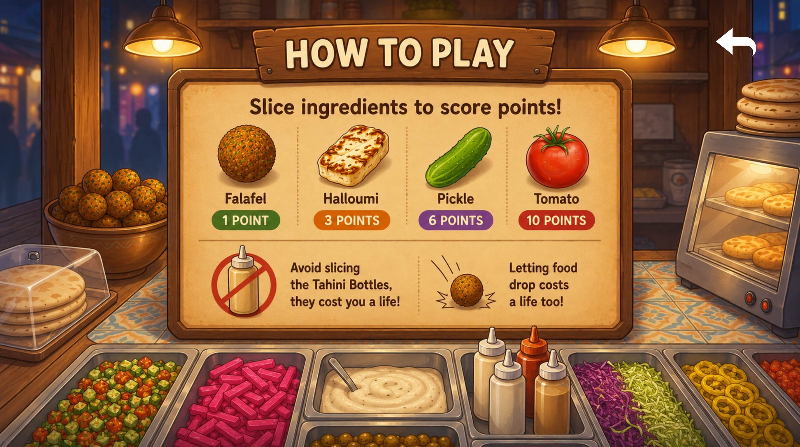
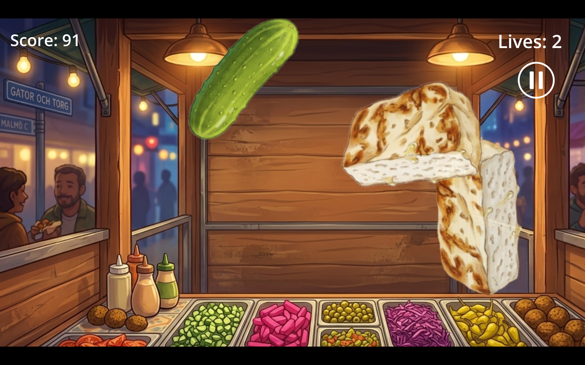
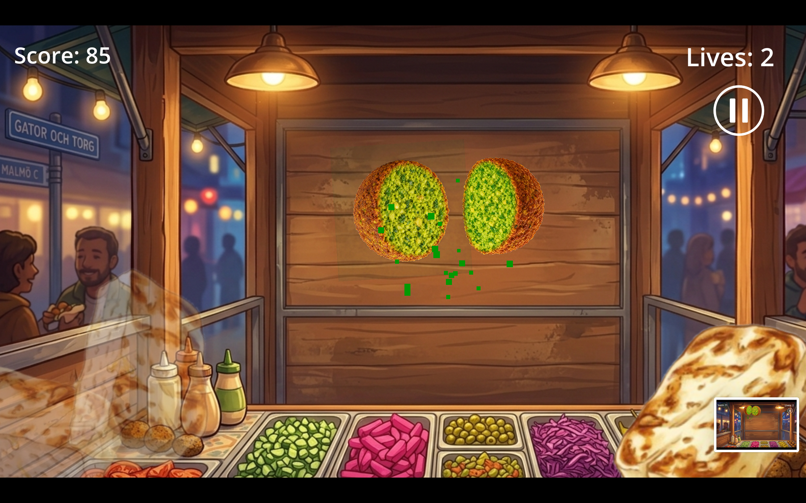
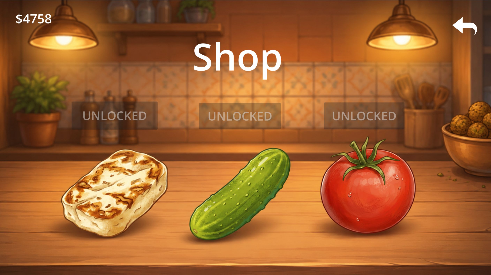
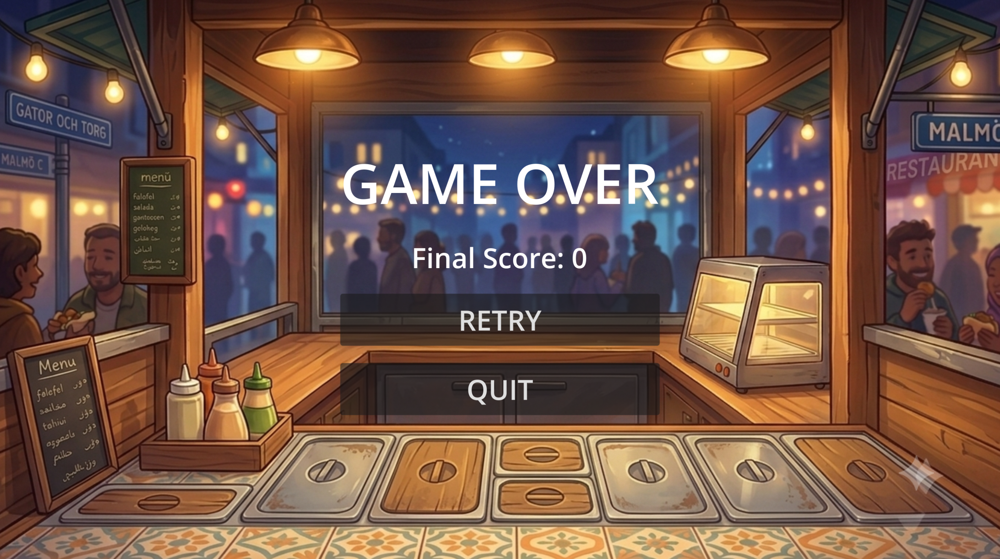

# falafel-frenzy
This is the beta version of our mobile game "Falafel Frenzy". You slice flying falafel balls and dodge the white sauce bottles. Play to collect coins and buy new ingredients like tomato, halluomi, and pickle. 

## Screenshots

How to install
1. Download the latest APK here 
2. Open the downloaded APK on your Android device.
3. If prompted, allow installation from this source in your Android settings.
4. Follow the on-screen instructions to install the game.
5. Open the game and enjoy!

Version: 1.0.0
Engine: Godot V.4.2
Platform: Android
